# Phần mềm cho shop, nhà trọ và hộ kinh doanh nhỏ

Bộ phần mềm tiếng Việt, **chạy ngay trên máy tính Windows của bạn**:
- Không cần mạng, không cần cài thêm gì.
- Dữ liệu nằm trên máy bạn, không gửi lên đâu cả.
- Tất cả đều cho **dùng thử 7 ngày đủ tính năng**. Hết hạn dùng thử, dữ liệu **không mất**: bạn vẫn xem, xuất và sao lưu được, chỉ không thêm mới cho tới khi kích hoạt.

📧 **Mua key / hỏi đáp:** duongkinhdoanh222@gmail.com

| Phần mềm | Dành cho | Tải bản dùng thử |
|---|---|---|
| 🏠 [Quản Lý Phòng Trọ](#-quản-lý-phòng-trọ) | Chủ nhà trọ 5–50 phòng | [⬇ Tải về (Windows)](https://github.com/DuongAI-ML/phan-mem-cho-shop-va-ho-kinh-doanh/releases/latest/download/QuanLyPhongTro-v1.0.0.zip) |
| 📒 [Sổ Sách Hộ Kinh Doanh](#-sổ-sách-hộ-kinh-doanh) | Quán ăn, tạp hóa, tiệm dịch vụ tự kê khai thuế | [⬇ Tải về (Windows)](https://github.com/DuongAI-ML/phan-mem-cho-shop-va-ho-kinh-doanh/releases/latest/download/SoSachHoKinhDoanh-1.0.0.zip) |
| 💅 [Lịch Hẹn Spa – Salon](#-lịch-hẹn-spa--salon) | Spa, nail, tóc, gym/yoga nhỏ | [⬇ Tải về (Windows)](https://github.com/DuongAI-ML/phan-mem-cho-shop-va-ho-kinh-doanh/releases/latest/download/LichHenSpa-1.0.0.zip) |
| 🤖 [Bot Trả Lời Fanpage](#-bot-trả-lời-fanpage) | Shop bán hàng qua Facebook | [⬇ Tải về (Windows)](https://github.com/DuongAI-ML/phan-mem-cho-shop-va-ho-kinh-doanh/releases/latest/download/BotTraLoiFanpage-1.0.0.zip) |
| 📊 [Lãi Lỗ Shop](#-lãi-lỗ-shop-shopee--tiktok-shop) | Người bán Shopee / TikTok Shop | Liên hệ email |
| 📗 [Bộ 3 Template Excel](#-bộ-3-template-excel--google-sheets) | Shop online, gia đình, kho hàng | Liên hệ email |
| 🧪 [Tool Test Tự Động](https://github.com/DuongAI-ML/tool-test-tu-dong) | Tester phần mềm | [Trang riêng](https://github.com/DuongAI-ML/tool-test-tu-dong) |

---

## Cách tải và cài (3 bước)

1. Bấm **⬇ Tải về** ở bảng trên → được file `.zip`.
2. Bấm chuột phải vào file zip → **Extract All / Giải nén tất cả**.
3. Mở thư mục vừa giải nén → **bấm đúp file `.exe`**. Trình duyệt sẽ tự mở giao diện phần mềm.

> **Windows hiện "Windows protected your PC" (màn hình xanh)?** Đây là cảnh báo thường gặp với phần mềm mới chưa mua chứng chỉ ký số, không phải virus. Bấm **More info / Thông tin thêm** → **Run anyway / Vẫn chạy**.
> Nếu phần mềm diệt virus chặn, hãy thêm file vào danh sách cho phép, hoặc email cho mình để được hướng dẫn.

**Yêu cầu máy:** Windows 10 hoặc 11 (64-bit). Chưa hỗ trợ Windows 7, macOS.

## Cách mua và kích hoạt key

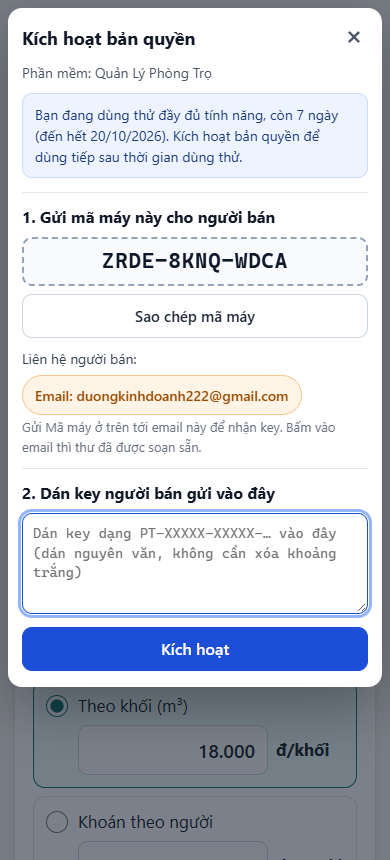

1. Trong phần mềm, bấm **Kích hoạt** trên thanh dùng thử.
2. Bấm vào email người bán: thư mua key **đã soạn sẵn kèm Mã máy** của bạn, chỉ cần gửi.
   Hoặc tự gửi **Mã máy** (dạng `ABCD-EFGH-JKLM`) tới **duongkinhdoanh222@gmail.com**.
3. Sau khi thanh toán, bạn nhận một **key**. Dán key vào ô trong hộp thoại → **Kích hoạt**. Xong.

Mỗi key dùng cho **1 máy tính**. Đổi máy hoặc cài lại Windows thì email lại để được cấp key mới.

 

---

## 🏠 Quản Lý Phòng Trọ

Mỗi tháng chỉ cần 3 việc: **chốt điện nước → gửi hóa đơn → ghi nhận trả tiền**.

- Nhập chỉ số điện nước mới, phần mềm **tự tính tiền**, kể cả giá điện bậc thang EVN, tính theo số người, phí rác, wifi, gửi xe.
- Tạo **ảnh hóa đơn có mã QR chuyển khoản** để gửi qua Zalo, kèm tin nhắn soạn sẵn.
- Biết ngay **ai đã trả, ai còn nợ**, có tin nhắc nợ để copy.
- Xử lý được trường hợp khó: đồng hồ quay vòng, thay đồng hồ, chuyển phòng giữa tháng, trả một phần, tiền cọc.
- Báo cáo thu theo tháng. Tự sao lưu mỗi ngày.

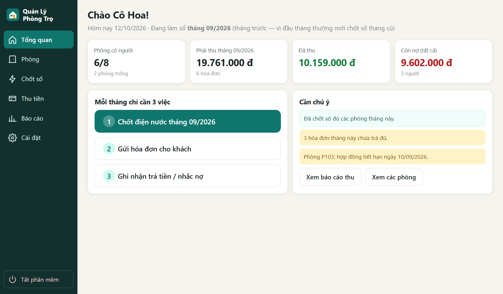 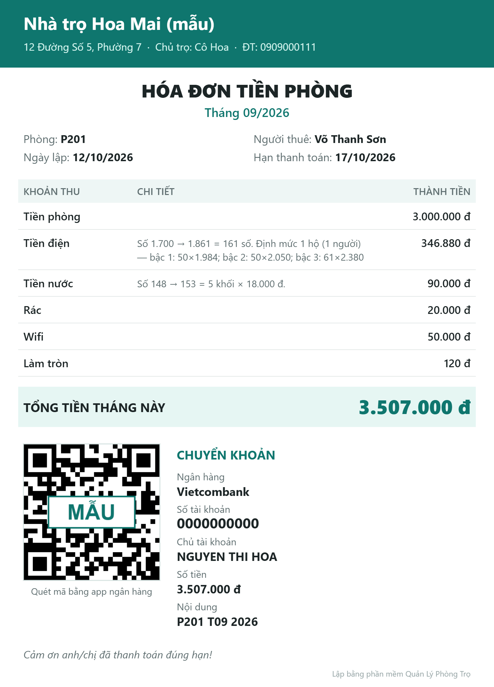

## 📒 Sổ Sách Hộ Kinh Doanh

Từ 2026 hộ kinh doanh bỏ thuế khoán và phải tự ghi sổ, kê khai. Phần mềm giúp việc này nhanh và đơn giản:

- Ghi một khoản bán hàng chỉ **vài lần bấm**, có bàn phím số lớn, gợi ý mặt hàng hay bán.
- Sổ theo mẫu dành cho hộ kinh doanh, tổng hợp doanh thu theo tháng / quý / năm.
- **Ước tính thuế** theo ngành nghề (tỷ lệ sửa được), nhắc hạn kê khai.
- Xuất sổ ra **Excel / CSV / bản in**.

> Số thuế là **ước tính** để bạn tham khảo. Hãy đối chiếu với cơ quan thuế hoặc kế toán.

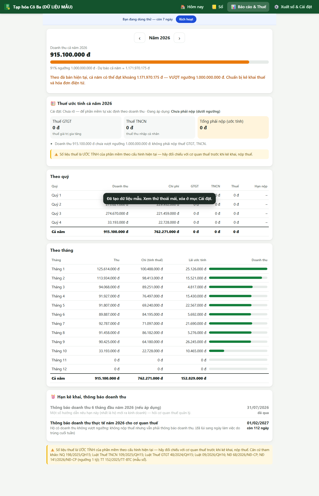 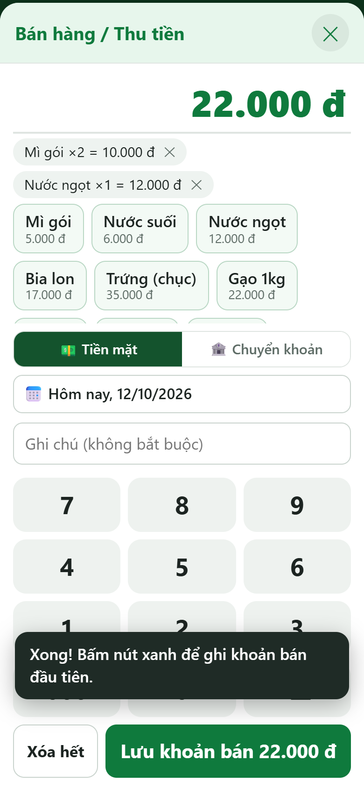

## 💅 Lịch Hẹn Spa – Salon

- Lịch hẹn theo ngày / tuần, **mỗi thợ một cột**, không cho đặt trùng giờ.
- Danh bạ khách, lịch sử dịch vụ, ghi chú (dị ứng, sở thích).
- **Gói liệu trình / thẻ tập**: mua 10 buổi, tự trừ buổi, báo hạn dùng.
- Thu tiền, doanh thu theo ngày và theo thợ, hoa hồng.
- **Tin nhắc lịch soạn sẵn** để copy gửi Zalo. Danh sách khách lâu chưa quay lại.
- Lễ tân dùng được trên **điện thoại cùng Wi-Fi** (bật trong Cài đặt, có mã PIN).

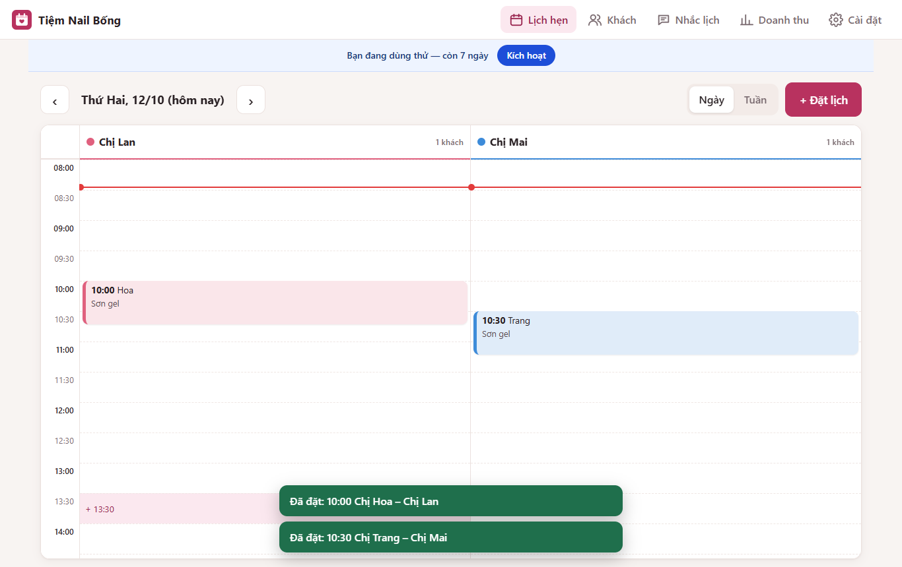 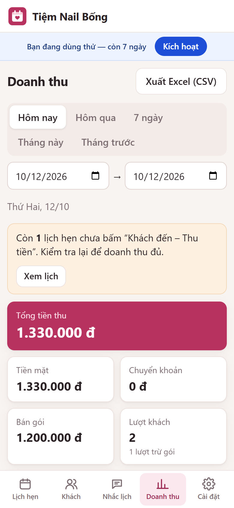

## 🤖 Bot Trả Lời Fanpage

Trả lời tin nhắn khách trên Facebook **khi bạn bận hoặc ngoài giờ**.

- Nhập sản phẩm, giá, phí ship, đổi trả, câu hỏi thường gặp bằng form đơn giản.
- **Miễn phí không cần AI**: hiểu câu hỏi kiểu "sp này bn", "ship ko", không dấu, viết tắt.
- **Chế độ AI** (tùy chọn): chỉ trả lời theo thông tin shop, không bịa giá. Có giới hạn chi phí mỗi ngày.
- Tự ghi lại **đơn đặt hàng** (tên, SĐT, địa chỉ) để bạn xác nhận. Chuyển cho người thật khi cần.
- Có trang **Chat thử** để xem bot trả lời trước khi nối Facebook.
- Kết nối Facebook Messenger chính thức. Bán theo **tháng / quý / năm**.

> Bot chỉ trả lời khi máy đang bật. Cần hỗ trợ cài đặt kết nối Facebook hoặc chạy trên máy chủ 24/7, hãy email.

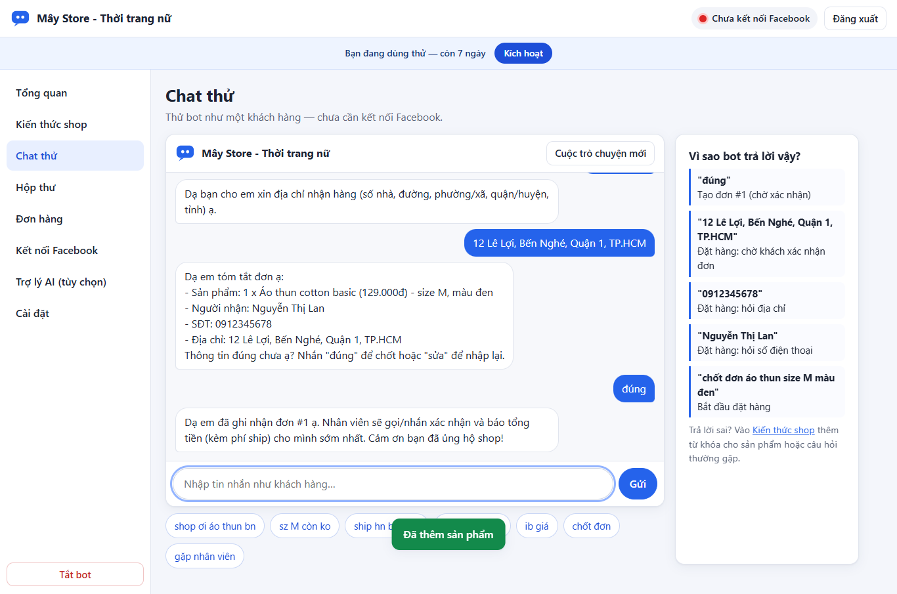 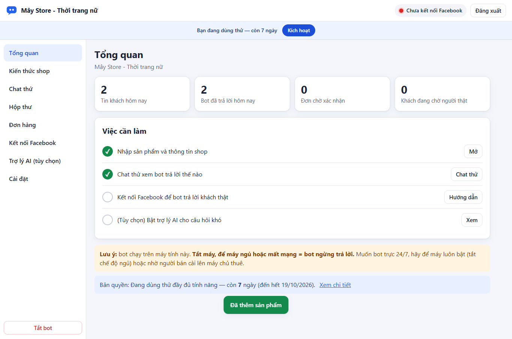

## 📊 Lãi Lỗ Shop (Shopee / TikTok Shop)

Tiện ích cho trình duyệt Chrome, Cốc Cốc, Edge:
- Biết **lãi thật** từng đơn và từng sản phẩm sau phí sàn, giá vốn, đóng gói, quảng cáo, hàng hoàn.
- Máy tính nhanh: "bán giá X lãi bao nhiêu", "muốn lãi Y% phải bán giá bao nhiêu".
- Nhập file đơn hàng xuất từ Seller Center. Không đọc thông tin khách hàng của bạn.

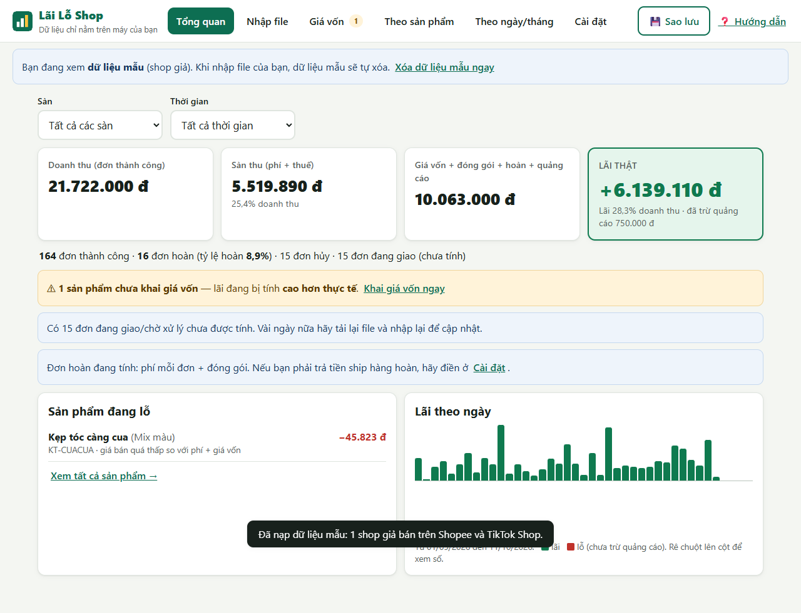 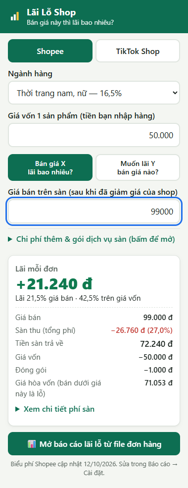

## 📗 Bộ 3 Template Excel / Google Sheets

**Quản lý shop online** · **Chi tiêu gia đình** · **Kho nhập – xuất – tồn**.
- Chỉ dùng hàm Excel cơ bản, không macro, nên mở được trên Excel đời cũ, WPS và Google Sheets.
- Có sheet hướng dẫn từng bước, ô nhập liệu tô màu riêng, ô công thức được khóa.

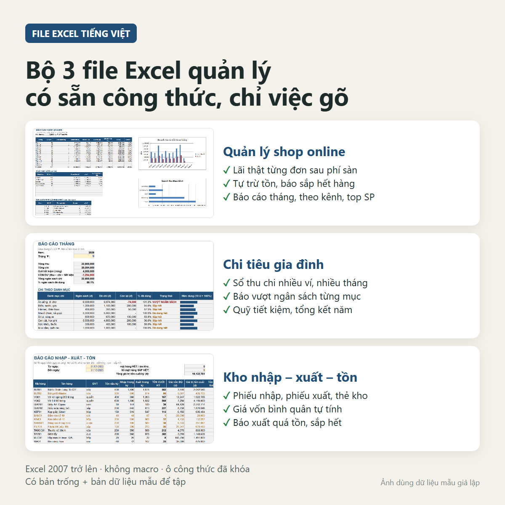 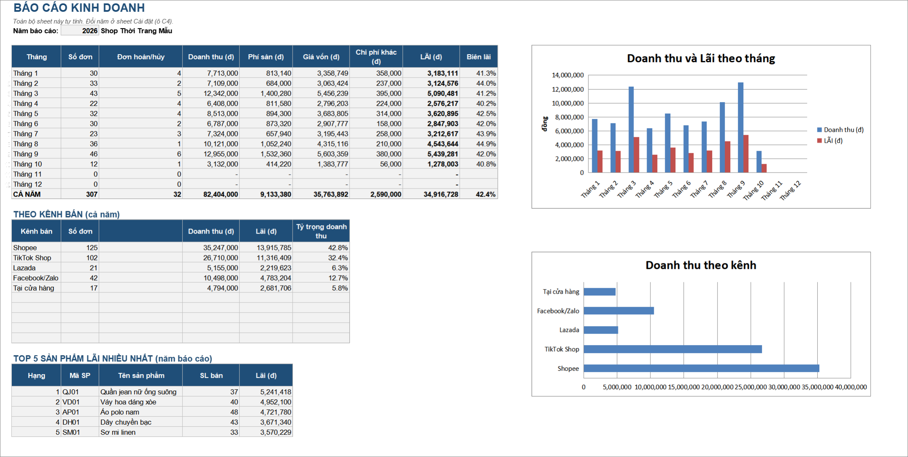

---

## Câu hỏi thường gặp

**Dữ liệu của tôi để ở đâu?** Trên chính máy bạn, trong thư mục `%LOCALAPPDATA%` của Windows. Phần mềm có nút **Sao lưu**, nên sao lưu định kỳ ra USB hoặc Google Drive.

**Hết hạn dùng thử thì có mất dữ liệu không?** Không. Bạn vẫn xem, xuất, sao lưu được. Chỉ không thêm hoặc sửa cho tới khi kích hoạt.

**Dùng trên điện thoại được không?** Phần mềm chạy trên máy tính Windows. Lịch Hẹn Spa – Salon cho phép mở thêm trên điện thoại cùng Wi-Fi.

**Máy Mac được không?** Hiện chưa.

---

© 2026 · Phần mềm thương mại, dùng thử miễn phí 7 ngày. Liên hệ: duongkinhdoanh222@gmail.com
